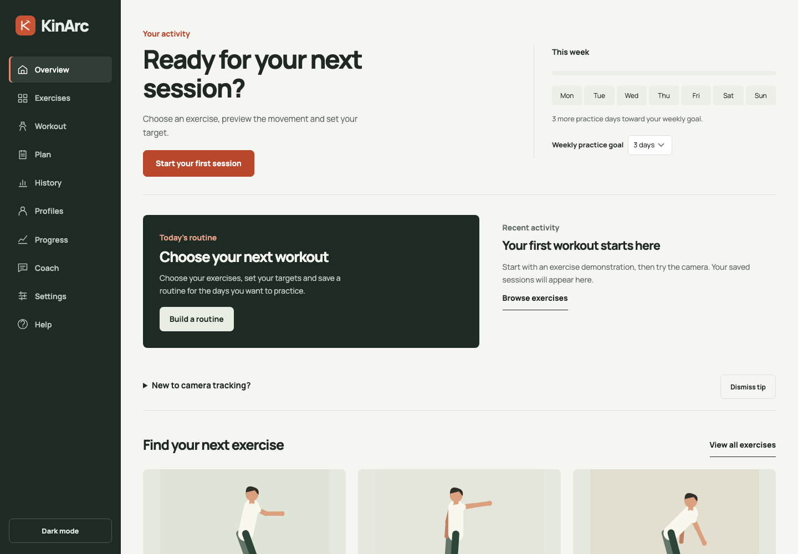
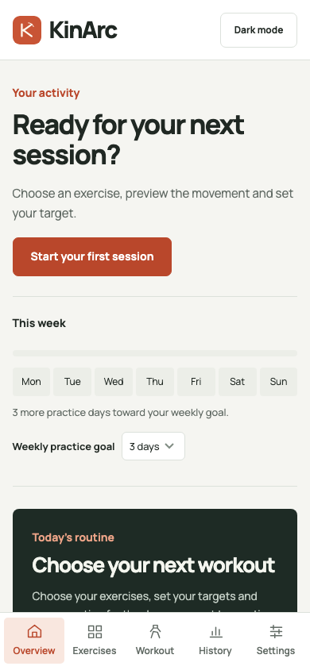

# KinArc — Camera-assisted exercise

KinArc is an installable, local-first movement web app with a dedicated public website and a focused workout interface. It includes guided exercise details, narrated demonstrations, multiple-set workouts, local video analysis, named routines, progress reports, account isolation and optional local generative coaching.

## Live demo

Open the deployed app at **https://sagardeepak671.github.io/KinArc/**.



The November 2026 product redesign is documented in [DESIGN_OVERHAUL.md](docs/DESIGN_OVERHAUL.md), with asset sources, design decisions and responsive screenshots.

## Start

Use Node 24 LTS and Python 3:

```sh
npm ci
npm run dev
```

Open **http://localhost:8770**. To serve the already-built release without Node:

```sh
python3 -m http.server 8765 --bind 127.0.0.1 --directory dist
```

Camera access requires localhost or HTTPS. A phone cannot use your computer's localhost address; deploy over HTTPS for phone/PWA use.

## Working features

- Guest onboarding with a display name, practice goal/duration, device coaching preference and camera/privacy guidance.
- Ten exercise definitions with body-area/difficulty/equipment filters, favorites, detail instructions, camera/joint requirements and supported correction limits.
- Clay demonstrations with narration/captions, speed, looping, restart and step controls; left/right tracking views.
- Positioning hold, countdown, configurable ranges, sets/reps/rest, pause/resume, visibility feedback, overlay control, fullscreen where supported and saved summaries.
- Local uploaded-video preview, validation, timestamp-stepped analysis, pause/cancel, saved angle timeline and results.
- Named routines with weekday schedules, duplication, ordering, per-movement targets, starter templates, deliberate next/skip and interrupted-run reconfiguration. Calendar reminders export as ICS files.
- IndexedDB per-account/profile storage with transactional legacy migration, stable IDs, deletion tombstones, cross-tab refresh and backup/restore.
- Real-data dashboards, weekly goals, tracked streaks, activity calendar, milestones, observed angle range charts and exact-value tables, searchable/paginated daily/weekly/monthly/all-time history, note editing, removal/Undo, CSV/JSON export and print view.
- Google sign-in and guest access behind an identity gate. Explicit guest-to-account import, profile rename/removal and local workspace erasure. No shared Firebase user is deleted.
- Optional record-level cloud synchronization with conflict choices, transactions, offline pending changes and status. **Production sync stays disabled until configuration/rules are verified.**
- Device voice/captions and an educational device guide; optional local Ollama/Piper coaching/chat with cancellation, health status, opt-in context and microphone input where supported.
- Desktop sidebar, phone bottom navigation, persistent light/dark/system themes, voice/settings controls, reduced motion, accessible dialogs, captions and large touch targets.
- Revisioned PWA shell and optional exercise downloads with progress/retry, offline navigation and safe app-update handling.

No real user's history is seeded. Synthetic rehearsals never credit tracked practice. All ten exercises are educational 2D tracking demonstrations, not clinically validated rehabilitation measurements. No unverified additional movement was marketed as tracked.

## Verify

```sh
npm test
npm run build
npx playwright install chromium
npm run test:e2e
npm run test:rules
```

`test:rules` requires Java 21+ and starts Auth/Firestore emulators for `demo-kinarc`, tests owner-only rules and runs account/sync browser tests. It never deploys rules. Browser tests include deterministic pose fixtures and a separate real bundled MediaPipe no-person video check. Physical movement/device accuracy still needs manual validation.

See [implementation status](IMPLEMENTATION_STATUS.md), [release report](docs/RELEASE_REPORT.md), [architecture](docs/ARCHITECTURE.md), [security review](docs/SECURITY_REVIEW.md), [data/cloud configuration](docs/DATA_AND_CLOUD.md) and [troubleshooting](docs/TROUBLESHOOTING.md).

## Deploy

Push this folder's contents (including `.github`) to your repository. Choose **Settings → Pages → GitHub Actions**. The workflow tests before deploying `dist`. Relative URLs and hash routes support repository subpaths. No remote repository or external Firebase resource was changed by this upgrade.

See [deployment instructions](docs/DEPLOYMENT.md). The static deployment supports guest/device-coach features; it cannot run the optional Python/Ollama/Piper service.

## Optional local generative coach

Install Ollama, then run:

```sh
./start-local.command
```

Open **http://localhost:8766**. First setup downloads the local model/voice and creates a Python environment. The server stays loopback-only; no paid API is required. Google consent and cloud sync require their own network/configuration; they are not made offline by installing the PWA.

## Source and release

Edit `src` and `public`, then run `npm run build`. `dist` is generated. Tests are in `tests`; local backend code is in `backend` and `local_server.py`. Model downloads, Python/node environments, user browser data, Git metadata, emulator logs/reports and the unsupported native scaffold are excluded from the release archive. Review [third-party notices](THIRD_PARTY_NOTICES.md) before redistribution.


