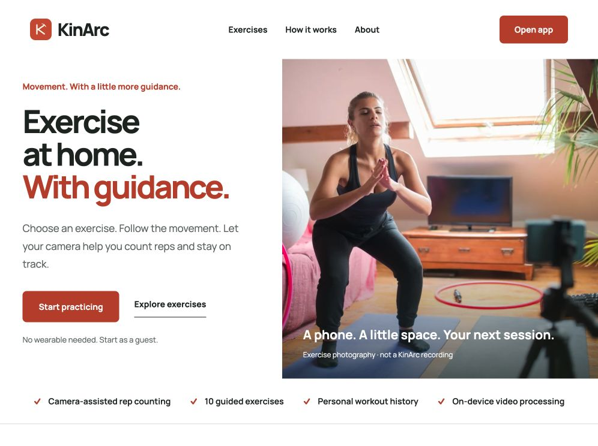

# KinArc — product design and UX implementation

Completed locally on **24 November 2026**. Final built web revision: **5d0129d17db4**. No Git push, production deployment, real Google-account change or production Firebase-rule deployment was performed.

## What changed

KinArc now separates a public product website from the working exercise application. The public homepage explains camera-assisted exercise with real home-workout photography, a concise workflow, supported exercise previews and honest descriptions of tracking, coaching and privacy. About, Privacy and a project-use notice have functioning routes.

The application uses a new shared visual system: locally hosted Manrope, warm white surfaces, deep green charcoal navigation, a coral primary action, restrained radii and conventional controls. Grain textures, decorative dashed labels, inflated buttons and repeated large cards have been removed. The arc-and-joint K identity is consistent across navigation, favicon and PWA icons. Light and dark modes remain functional.

The practical screens were redesigned together:

- **Overview:** one prominent workout action, actual weekly activity, scheduled routine, recent sessions, intentional first-session guidance and curated discovery. Empty activity statistic tiles are hidden for new users.
- **Exercise library:** a dedicated route, ten original exercise-specific visuals, combined search/body-area/difficulty/equipment/favorite filters and tracking labels.
- **Exercise details:** visual and narrated demonstration, target configuration, equipment, camera view, step-by-step instructions, favorite control and supported measurement limits. Targets transfer to the real workout setup.
- **Workout:** setup appears before the idle preview on phones; the camera takes priority during an active session. Start actions precede optional advanced controls. Counts, time, set, phase, voice cues, pause and save remain connected to real workout state.
- **Routine planner:** compact named-routine toolbar, weekday selection, templates, exercise ordering and editable targets, with existing run/resume/skip and calendar export.
- **History:** compact metrics, readable activity bars, exercise breakdown, ruled session entries, search/filter controls, CSV export, note editing, session details, removal and Undo.
- **Progress:** real activity calendar and milestones, plus an observed min–max angle chart and exact-value table. Brief sessions show seconds rather than rounding their entire duration to zero minutes. No recovery score is invented.
- **Coach:** readable conversation width, useful question prompts, distinct messages, clear local-service status, optional context and speech controls.
- **Settings and profiles:** conventional grouped settings, real save feedback, profile/account controls, backup/restore and offline-download status.
- **Onboarding:** optional, concise and deferred until app entry; public exercise exploration stays unobstructed. Camera access is only requested by Start camera.

## Functionality and data preservation

The existing MediaPipe/tracker, repetition algorithm, demonstrations, local AI backend, Firebase identity boundary, database schema, synchronization model and deployment workflows were retained. Existing records are neither replaced nor seeded with marketing data. Original data migration and backups remain in place.

Important interaction fixes include unobstructed public exercise details, preservation of configured targets through optional setup, safe mobile stage reordering, correct skip-link behavior and immediate resetting of video-analysis status. The repeated-video routine test caught stale completion text that could make the second video appear finished too soon; this is fixed.

The asset, implementation and design rationale is recorded in [design/DECISIONS.md](design/DECISIONS.md). Three composition studies are in [design/directions.svg](design/directions.svg).

## Assets

Two real photographs are locally bundled with optimized WebP versions and JPEG fallbacks. All ten exercise thumbnails are original, consistent instructional SVG illustrations; narrated clay demonstrations remain functional. The photographic series for every individual exercise was not supplied, so the catalog uses matching original illustrations rather than unrelated stock photos. A verified photo shoot is a remaining optional asset upgrade.

Sources and licenses: [design/ASSETS.md](design/ASSETS.md), [THIRD_PARTY_NOTICES.md](../THIRD_PARTY_NOTICES.md). No reference-site imagery, testimonials, partnerships, certifications or customer counts were copied or invented.

## Verification

| Check | Result |
| --- | --- |
| Production build under Node 24 | Passed; final revision above |
| Existing unit/integration suite | 43 passed, 0 failed |
| Full Chromium end-to-end suite | 24 passed, 0 failed |
| Final copy/layout polish checks | 5 browser cases passed; final duration/target/layout checks: 2 passed |
| Firestore emulator rule tests | 2 passed, 0 failed |
| Firebase Auth/account synchronization browser tests | 2 passed, 0 failed; demo emulator only |
| Automated WCAG 2 A/AA and 2.1 AA scans | 22 scans across 11 routes and both themes; 0 reported violations |
| Dependency audit, including development dependencies | 0 vulnerabilities reported |
| Current local AI server health | Available; existing qwen2.5:3b / Piper configuration |

The browser suite covers onboarding, search/favorites, detail targets, demonstrations, real tracker integration using synthetic landmarks, camera-denial recovery, sequential video analysis, multiple sets, pause/resume, saved sessions, routines, data isolation, backup/restore, corruption recovery and offline use. The bundled real MediaPipe graph also initialized and analyzed a no-person clip without false reps. This is distinct from testing actual human exercise accuracy.

Screenshots and overflow/resource checks cover **320, 390, 768, 1024, 1440 and 1920px**, light and dark. There are 132 primary route/theme/width cases, plus 12 detail views and four trial-dialog views. Full captures, populated-history examples and active phone-workout evidence are in [design/screenshots](design/screenshots). Machine-readable results: [visual matrix](design/visual-matrix.json), [accessibility](design/accessibility.json). Contact sheets for visual review are in [design/review](design/review). Screenshots showing saved activity use isolated test sessions, not genuine user activity or fabricated product achievements.

Visual review checked hierarchy, photo cropping, navigation, controls, labels, empty states and consistency. It led to real fixes for 320px image overflow, 1920px public-page centering, cropped thumbnails, delayed camera actions, repetitive onboarding content and desktop footer alignment. The local preview was opened and inspected through the in-app browser as well as the reproducible screenshot suite.

Local Chromium observed app-ready time was approximately 253ms and loaded resource transfer about 978KB in one run. These figures are not a physical-phone or mobile-network benchmark. Automated accessibility results are not a complete assistive-technology certification.

## Run and verify

Use Node 24 LTS and Python 3:

```sh
npm ci
npm run dev
```

Open `http://localhost:8770/#landing`. Returning users can use `#home`. For the optional local generative coach, run `./start-local.command` and use `http://localhost:8766/`.

The included built application also runs without installing Node dependencies:

```sh
python3 -m http.server 8770 --bind 127.0.0.1 --directory dist
```

Verification commands:

```sh
npm test
npx playwright install chromium
npm run test:e2e
npm run test:rules
npm audit
```

Firebase emulator checks require Java 21. Production cloud sync remains off until its configuration and owner-only rules are independently verified. For a phone, use a deployed HTTPS address; a phone's localhost is not your computer.

Generate a clean source + built-web archive with `python3 scripts/package-release.py /absolute/output/KinArc-complete-web.zip`. It excludes local secrets, model downloads, node_modules, virtual environments and native scaffolding, while including the source, built app, bundled tracking assets, tests and documentation.

## Remaining external verification

- Physical Android/iPhone camera, browser speech voices, codecs and install behavior were not tested on actual devices.
- Real deployed Google consent/authorized domains and production Firestore rules remain owner setup/verification steps. Emulator success does not prove real production configuration.
- Movement tracking remains an unvalidated 2D estimate; no clinical or universally correct-form claim is made.
- Optional generative coaching requires the local backend and model downloads. Static deployment provides the device guide, not an online generative service.
- A public commercial operator should provide their own support identity and reviewed legal terms. The app does not invent a company or support email.


