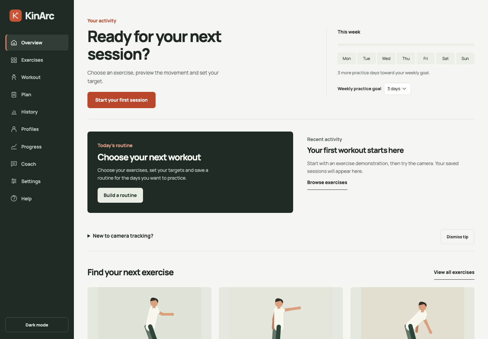
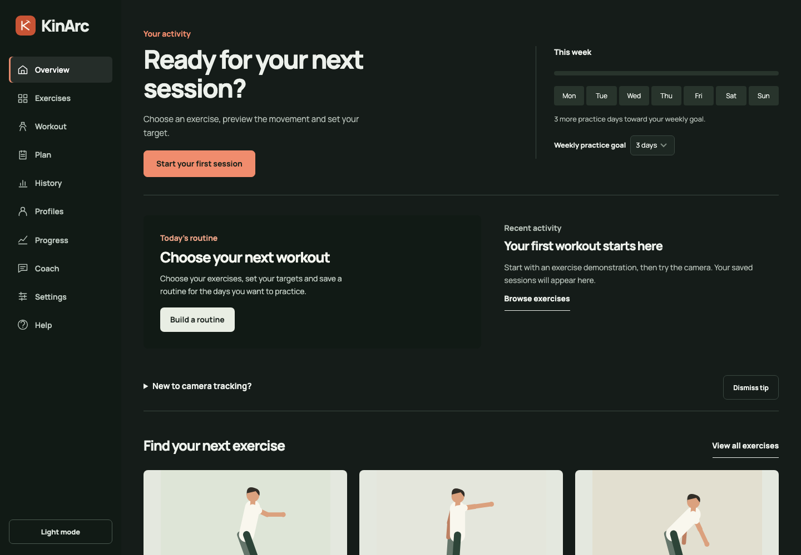
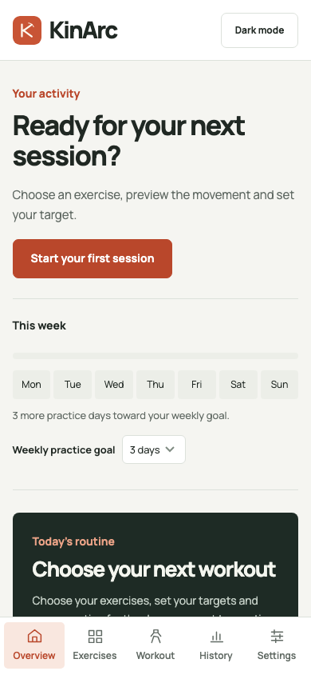
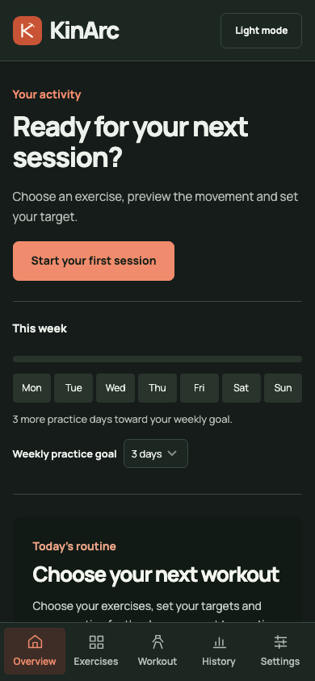
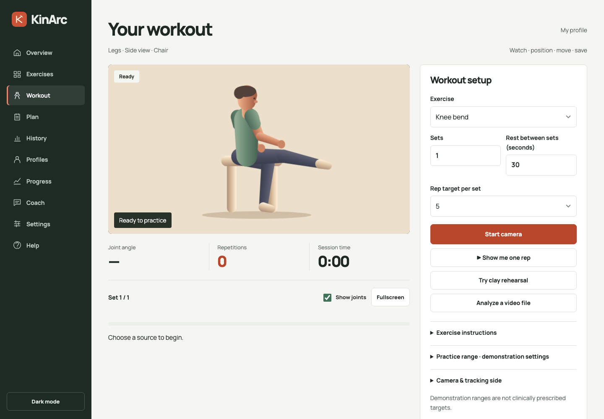
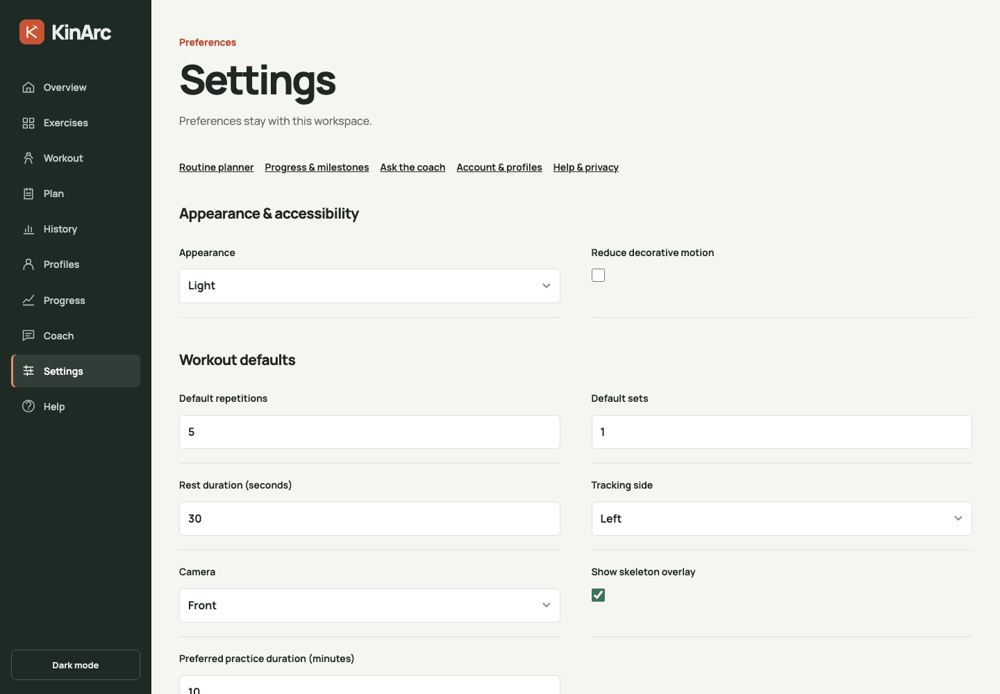
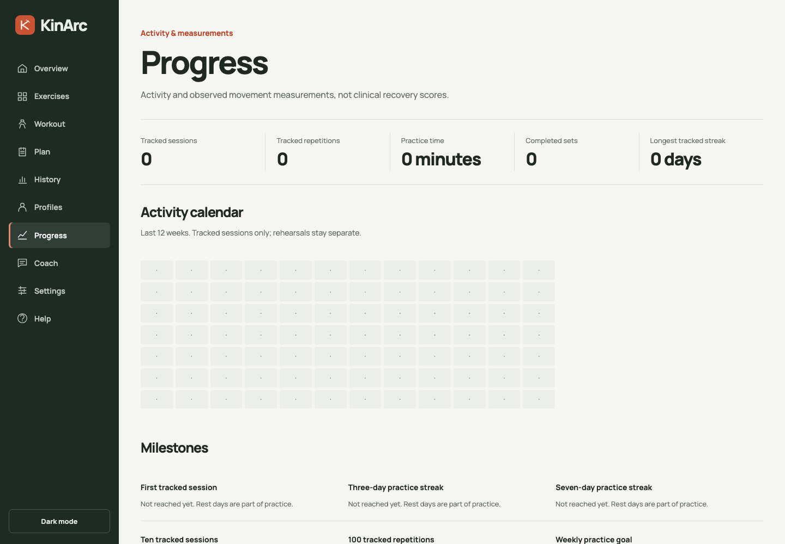
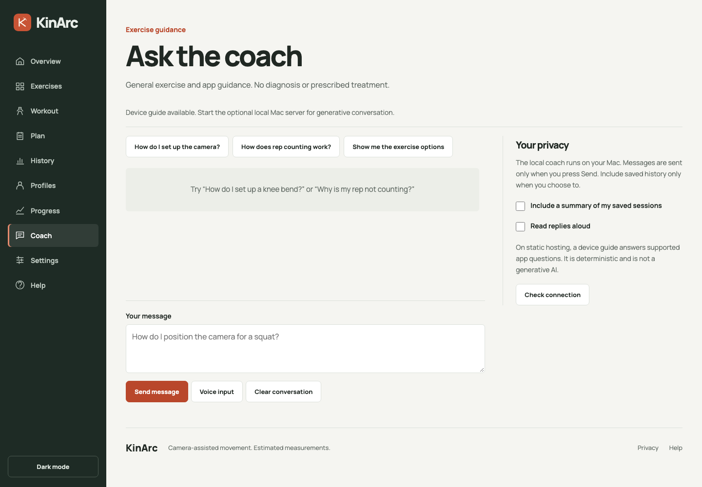

> The subsequent 24 November product design and UX overhaul is documented in [DESIGN_OVERHAUL.md](DESIGN_OVERHAUL.md), with updated screenshots and verification. The report below describes the earlier functional release.

# KinArc upgrade release report

Date: 2026-11-23. Status: verified local web/PWA release candidate. Production cloud activation and real-device movement validation remain explicit external checks.

## 1. What was implemented

The application now connects onboarding → profile → exercise details → configured workout → sets/rest → saved summary → journal/progress. A separate video workflow previews, validates, analyzes and saves a bounded movement timeline. The supported runtime is a static-compatible web/PWA application with optional local services.

The ten existing exercises remain supported. Definitions now centralize their joints, camera views, thresholds, instructions, equipment and limitations. No additional exercise was labelled tracked without a defensible measurement path.

## 2. Existing bugs fixed

- Account-local history could render before Firebase identity resolved. Startup now gates the workspace and ignores local UID hints as authentication.
- A saved rehearsal opened a tracked-only history filter and appeared missing. The summary now opens the matching inclusive journal view.
- Rep milestones could be dropped while speech was playing. They queue, use the current remaining count and yield to sustained corrections.
- Small-model live corrections could contradict measured guidance. Supported corrections retain authoritative wording; the model adds encouragement. Named-exercise chat setup answers are grounded in the canonical guide.
- Video analysis depended on real-time playback and could skip observations. It seeks sequentially by video timestamp, with explicit pause/cancel and bounded inputs.
- Resuming video analysis could restart normal video playback and destabilize timestamps. It now resumes paused timestamp stepping.
- Multi-set totals, completed-set attribution and summary targets were missing or misleading. Totals and per-set targets are separated; tracked completion checks exact item/exercise/side/reps/sets.
- Paused time and the timer after completion could inflate duration. Pause is excluded and completed workouts stop the clock.
- Backup reloads could race pending persistence. Important saves/restores await transactions and failed restores retain the previous database.
- Legacy corruption could fail unpredictably in downstream views. It is checked at migration and can be downloaded as a scoped recovery file without opening another account.
- A compound animation could move an unrelated arm. Standing hamstring practice now holds a support and keeps the free arm steady; squat/good-morning/front-raise poses were differentiated and joint geometry corrected.
- Offline camera validation used a HEAD request that bypassed cached model data. It now validates through the cacheable asset path.
- Update activation in another tab could reload an active session. Active workouts now remain running; updates wait for a safe reload.

## 3. Architecture

Editable files are in `src`, static assets in `public`, and generated deployment output in `dist`. esbuild bundles only required Firebase entry points. Domain modules separate identity, IndexedDB, sync, exercises, tracking, workout states, settings, providers, coaching, reports, routines and reusable UI helpers.

IndexedDB stores scoped individual records and deletion markers. A compatibility projection connects the existing interface without an unnecessary framework rewrite. Migration and restore use transactions; source localStorage remains as a recovery copy until explicit workspace erasure. Same-account tabs receive data refresh/sign-out signals.

See ARCHITECTURE.md for the full data and lifecycle design.

## 4. New user-facing features

- Three-step optional onboarding with guest/Google choices, display name, preferred duration, weekly goals, voice and camera/privacy guidance.
- Personalized dashboard with real practice days, streak, recent/favorite exercises, scheduled routine and session duration.
- Search plus body/difficulty/equipment/favorite filtering; individual exercise detail views and supported measurement explanations.
- Tactile design tokens, custom navigation icons, desktop sidebar, phone bottom tabs and coherent light/dark/system settings.
- Clay trials with play/pause, restart, speed, loop, narration/captions and step controls.
- Positioning hold, countdown, multiple sets, rest timer, configurable ranges, pause/resume, visibility state, overlay/fullscreen controls and a saved summary.
- Video preview, local timestamp analysis, progress, pause/cancel, rep/angle results and a readable timeline.
- Named, duplicated and reordered routines; weekdays, sets/reps/rest/side editing; deliberate next/skip, partial completion and safe resume configuration. Reminders export to calendar files.
- Google/guest isolation, explicit guest transfer, profile editing/removal, local workspace erasure, full JSON backups and optional cloud content removal when configured.
- Opt-in per-record sync with revision conflicts, deletion propagation, status/retry and listener-based remote updates. Production remains off.
- Daily/weekly/monthly/all-time history, search/pagination, note editing, confirmed removal/Undo, detail dialogs, CSV/JSON export, print view, activity calendar and real-data milestones.
- Device coach plus optional local generative chat, health, cancel/retry/fallback, history-summary consent, microphone opt-in where supported and spoken replies.
- Revisioned PWA shell, optional larger exercise downloads with progress/retry and safe app updates.

## 5. Actual test results

| Suite | Passed | Failed |
|---|---:|---:|
| Unit/integration (Node 24) | 43 | 0 |
| Chromium end-to-end workflows | 18 | 0 |
| Firestore emulator rule cases | 2 | 0 |
| Auth/Firestore emulator browser cases | 2 | 0 |
| Live local Ollama/Piper API cases | 7 | 0 |

The browser suite includes viewport checks at 320, 390, 768, 1024 and 1440 pixels; offline navigation/download; onboarding/settings; profile handling; backup/recovery; multiple sets; camera denial; synthetic camera/video counts; video pause; full routine completion; note edits/removal/Undo; snapshots and console exception checks.

Synthetic pose fixtures test rep algorithms separately from the bundled real MediaPipe test. The latter initializes the actual WASM/model and analyzes a no-person clip with zero false reps. It does not establish real human movement accuracy.

Local AI checks use the actual installed model/voice, testing health, grounded setup guidance, corrective WAV speech, symptom referral, request schema/size and untrusted-Origin rejection. Other automated tests use only `demo-kinarc` emulators, never production user data.

Production build, first-party JS/Python/shell parsing and whitespace checks pass. The final npm audit reports zero known vulnerabilities, including development dependencies after tested overrides. See `qa-results.json` for machine-readable totals.

A local Chromium sample observed approximately 232 ms app-ready time and 828,414 resource bytes before pose use. This is a localhost fixture run, not a mobile network benchmark. The pose assets are lazy-loaded, inference is sequential, video samples are bounded, and journal rendering is paginated.

## 6. Screenshots










Dark versions of the important screens are also in `screenshots/`. Screenshots show empty/new-user data unless generated by explicit test fixtures; no real activity was fabricated in the application.

## 7. Commands

```sh
npm ci
npm run dev                  # http://localhost:8770
npm run build
npm start                    # existing dist at http://localhost:8765
npm test
npx playwright install chromium
npm run test:e2e
npm run test:rules            # Java 21+, demo emulators only
./start-local.command        # optional local AI, http://localhost:8766
npm run test:local-ai         # optional, requires running local service/model
```

Node 24 LTS is recommended. See DEPLOYMENT.md for prerequisites and alternate Java paths.

## 8. Deployment

Push the project folder's contents to GitHub and select GitHub Actions in Pages settings. The included workflows install dependencies/runtimes, test, build and deploy `dist` only after successful checks. They do not publish Firestore rules. Any static host can publish the generated `dist`; relative assets/hash navigation support repository subpaths.

The upgrade did not push a repository or change a production service. Static deployment supports guest/device-coach functionality. It cannot run a visitor's local Ollama/Piper service.

## 9. External configuration still required

1. Authorize the final deployment hostname and complete a real Google consent check.
2. Prefer a dedicated production Firebase project, or audit the shared project's broader rules. Merge only the KinArc rule block, verify owner isolation/region/quotas and then enable `cloudEnabled`. Production sync is off until this is done.
3. Test the final HTTPS app on actual Android/iOS devices: camera positioning, codecs, speed, speech voices, permissions and installation.
4. Review privacy/support information and choose a source-distribution license before a public release. Third-party notices and license copies are included.

## 10. Known limitations / unverified items

- This is an educational movement app without clinical validation. 2D landmarks do not verify spinal alignment, grip, load, balance or every movement mistake.
- No new unvalidated exercise, native APK/IPA, paid AI provider or background push service was claimed. Calendar reminders require user import and the calendar app's delivery.
- Real Google authentication, the deployed project's complete ruleset, device-specific camera/speech and non-Chromium browsers require final external checks. Emulators do not certify the shared production configuration.
- Guest/account data is not encrypted against someone using the same browser profile/devtools. Identity gating prevents accidental UI mixing, not local forensic access.
- Very large histories beyond tested fixtures need additional scale testing; the compatibility projection loads the active workspace in memory.
- Draft recovery restores configuration and routine position; it never silently credits unfinished reps or restarts a camera.
- Client cancellation discards stale AI output; a local Ollama generation already in progress can continue until its bounded timeout. Free-form model replies may still be inaccurate; authoritative exercise instructions and supported live corrections take precedence.
- WCAG certification and real-device movement validation have not been claimed. Accessibility includes keyboard/focus, labels/dialogs, captions, text equivalents, touch targets and reduced motion.
